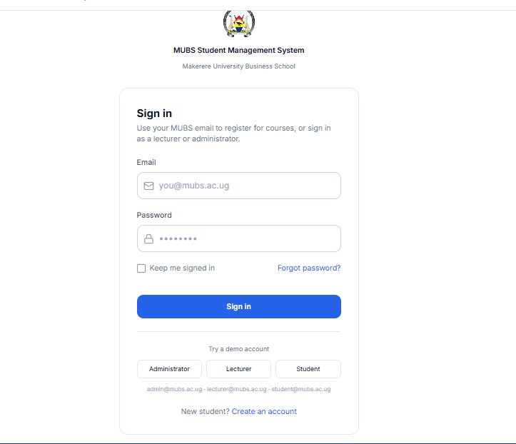
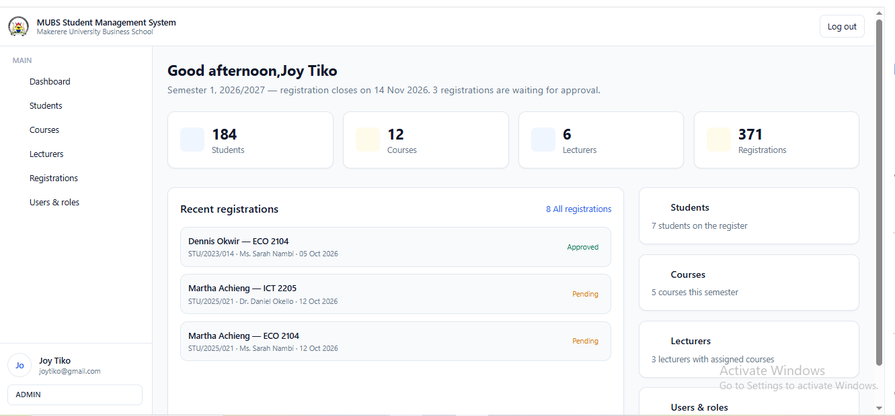
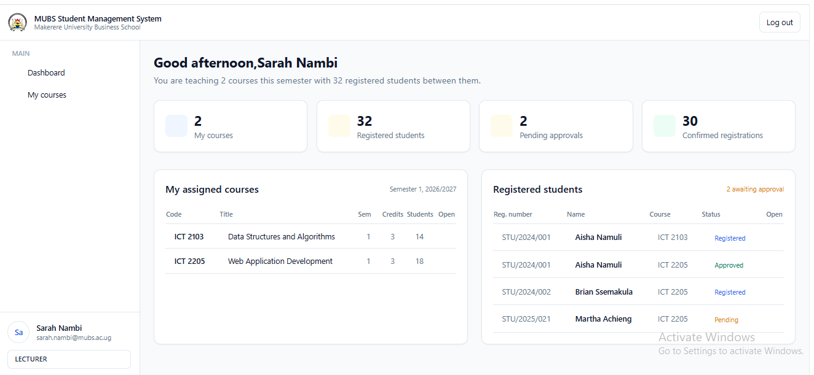
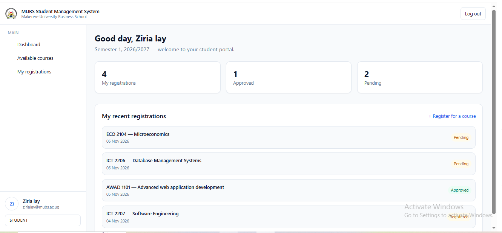
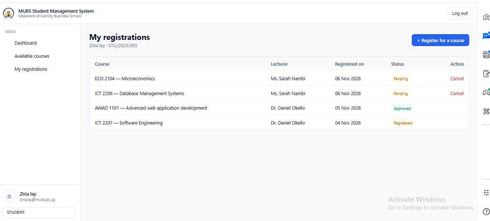
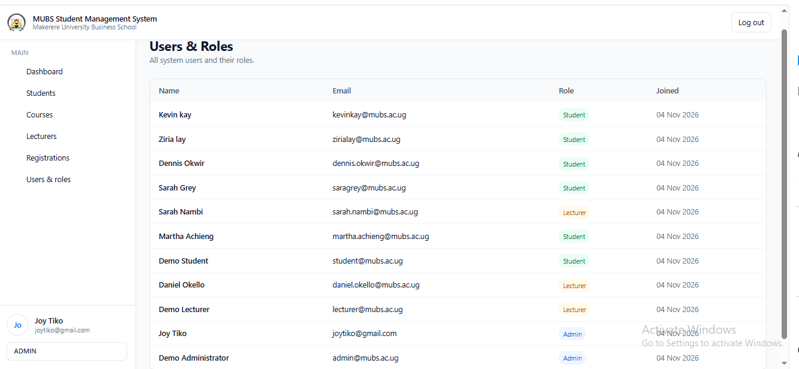
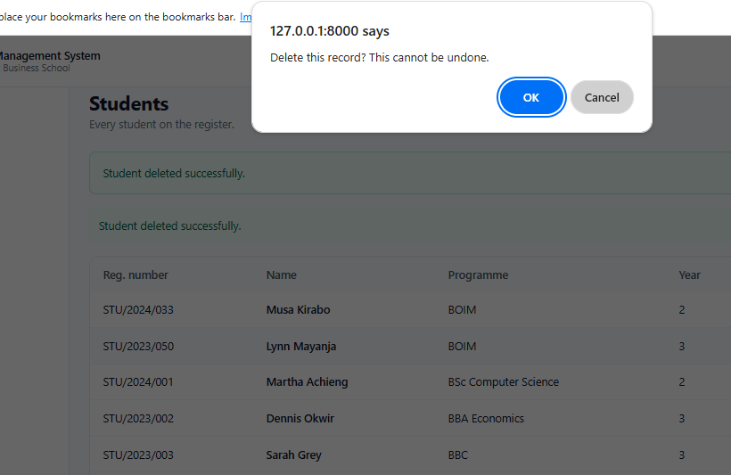
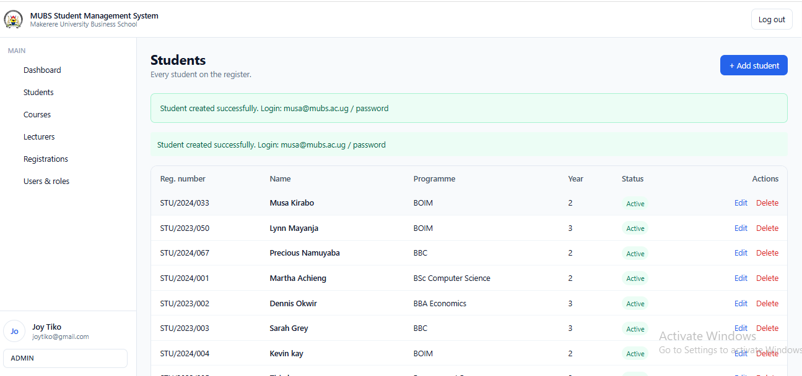

# MUBS Student Management System

A Laravel web application for managing students, courses, lecturers and course registrations at Makerere University Business School.

Course: Advanced Web Application Development (BUC3131), Academic Year 2026/2027

## Group members

| Name | Registration number | Contribution 
| Mpotaima Ziriyah | 24/U/0706 |  Documentation - blade view layouts -feature/updated seederfiles   |
| Namuyaba Precious | 24/U/09419/PS |  feature/q4-complete  Application functionality|
| Kirabo Isaac Musa | 24/U/24078/PS | feature/auth-roles Q3|
| Manana James Joshua | 24/U/06641/EVE | feature/database-relationships q1 |
| Mukaga Kevin Wanyama | 24/U/07162/PS| feature/seeders  Q2 seeders and sample data|
| Nankanja Sarah | 24/U/22937| feature/contact-page and index  - blade layouts and links|

## Features

- Authentication with role-based access (Spatie Laravel Permission)
- Administrator: manages students, courses, lecturers, registrations and users
- Lecturer: views assigned courses and their registered students
- Student: views available courses, registers, and sees their own registrations
- Duplicate registration prevention
- Validation and success/error messages

## Requirements

- PHP 8.3 or higher
- Composer
- MySQL (XAMPP)
- Node.js and npm

## Installation

1. Clone the repository:

   ```
   git clone [https://github.com/mpotaimaziriyah-coder/student-management-system]
   cd student-management-system
   ```

2. Install dependencies:

   composer install
   npm install
   

3. Create the environment file:


   copy .env.example .env
   php artisan key:generate
   

4. Create a MySQL database (for example `Mubs_Student_Management`) in phpMyAdmin.

5. Edit `.env`:

   ```
   DB_CONNECTION=mysql
   DB_HOST=127.0.0.1
   DB_PORT=3306
   DB_DATABASE=Mubs_Student_Management
   DB_USERNAME=root
   DB_PASSWORD=
   ```

6. Create the tables and sample data:

   php artisan migrate:fresh --seed
   ```

7. Start the application:

   php artisan serve
   ```

8. Open http://127.0.0.1:8000

## User roles and sample logins

| Role | Email | Password | Can do |
|------|-------|----------|--------|
| Administrator | admin@mubs.ac.ug | password | Manage students, courses, lecturers, registrations, users |
| Lecturer | lecturer@mubs.ac.ug | password | View assigned courses and registered students |
| Student | student@mubs.ac.ug | password | View available courses, register, view own registrations |

Other seeded accounts (all with password `password`): joytiko@gmail.com (admin), daniel.okello@mubs.ac.ug and sarah.nambi@mubs.ac.ug (lecturers), and the seeded students.

## Database design

- `users`: login accounts
- `students`, `lecturers`, `courses`
- `registrations`: links students to courses (unique on student + course, with foreign keys)
- Spatie tables: `roles`, `permissions`, `model_has_roles`, `role_has_permissions`

Relationships: a lecturer has many courses; a course belongs to a lecturer; a student and a course are linked many-to-many through registrations.

## Screenshots


















## GitHub workflow

- `main`: stable codes
- `develop`: integration
- Feature branches: `feature/application-functionality, feature/auth-roles,feature/blade layout,feature/blade view,feature/contact-page,feature/course-seeder,feature/database-relationships,feature/header-changes`, merged into `develop` through pull requests


# Contribution Report

**Project:** MUBS Student Management System
**Course:** Advanced Web Application Development (BUC3131), Academic Year 2026/2027
**Repository:** https://github.com/mpotaimaziriyah-coder/student-management-system

## Group members and tasks

| Member | Reg. number | Assigned tasks | Branch |
| Mpotaima Ziriyah | 24/U/0706 |  Q6 Documentation (README, screenshots, contribution report), Blade view layouts | feature/updated-seederfiles, documentation |
| Namuyaba Precious | 24/U/09419/PS | Q4: Application functionality (student CRUD, course CRUD, registration) | feature/q4-complete |
| Kirabo Isaac Musa | 24/U/24078/PS | Q3: Authentication, roles and permissions | feature/auth-roles |
| Manana James Joshua | 24/U/06641/EVE | Q1: Database design and relationships | feature/database-relationships |
| Mukaga Kevin Wanyama | 24/U/07162/PS | Q2: Seeders and sample data | feature/seeders |
| Nankanja Sarah | 24/U/22937 | Q5: Blade layouts, validation and links; contact page and index | feature/contact-page |

## Branching strategy

- `main`: stable, tested code
- `develop`: integration of all features
- `feature/*`: one branch per member, merged into `develop` through pull requests

## Pull requests

| # | Title | From | Into | Author | Status |
|---|-------|------|------|--------|--------|

| [#31,29,24,22,]| feature/updated-seederfiles | develop | Mpotaima Ziriyah | Merged |
| [#31,29,24,22,32]| feature/updated-seederfiles | develop | Mpotaima Ziriyah | Merged |
| [#15,30,17] | feature/q4-complete | develop | Namuyaba Precious | Merged |
| [#25,7] | feature/auth-roles | develop | Kirabo Isaac Musa | Merged |
| [#11]  | feature/database-relationships | develop | Manana James Joshua | Merged |
| [#13] | feature/seeders | develop | Mukaga Kevin Wanyama | Merged |
| [#12,14,8,]  | feature/contact-page | develop | Nankanja Sarah | Merged |
| [#] | develop to main | develop | main | [name] | Merged |


## Commit summary

| Member | Commits |
|--------|---------|
| Mpotaima Ziriyah | 32 |
| Namuyaba Precious | 10 |
| Kirabo Isaac Musa | 4 |
| Manana James Joshua | 1 |
| Mukaga Kevin Wanyama | 3 |
| Nankanja Sarah | 18 |

## Testing before merge

`develop` was tested with `php artisan migrate:fresh --seed`. The administrator, lecturer and student logins and the main features (student and course management, registration, role-based dashboards) were checked before merging into `main`.